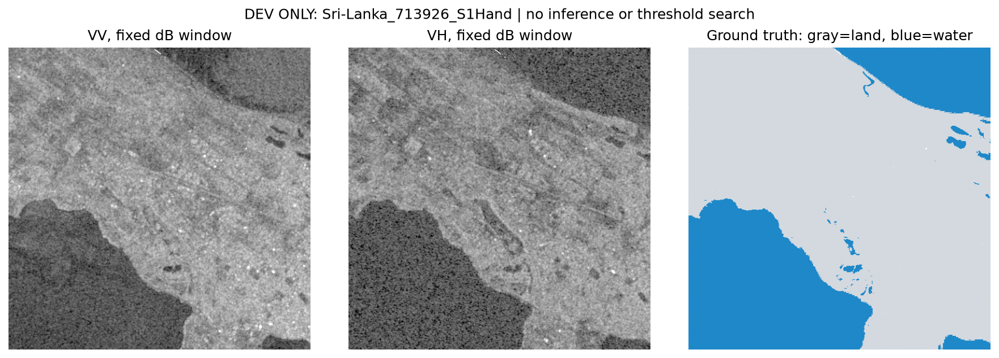
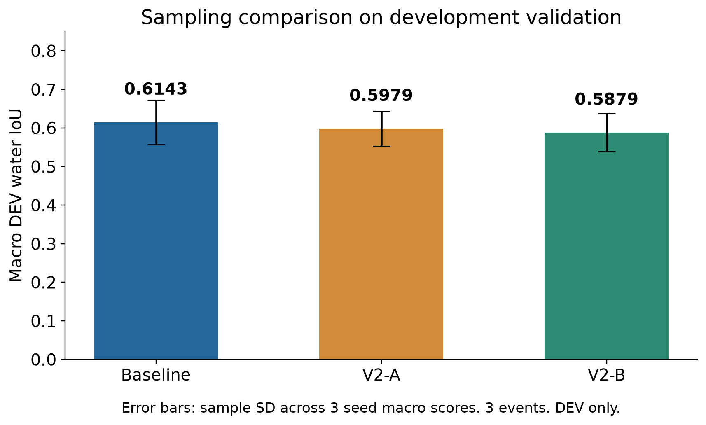
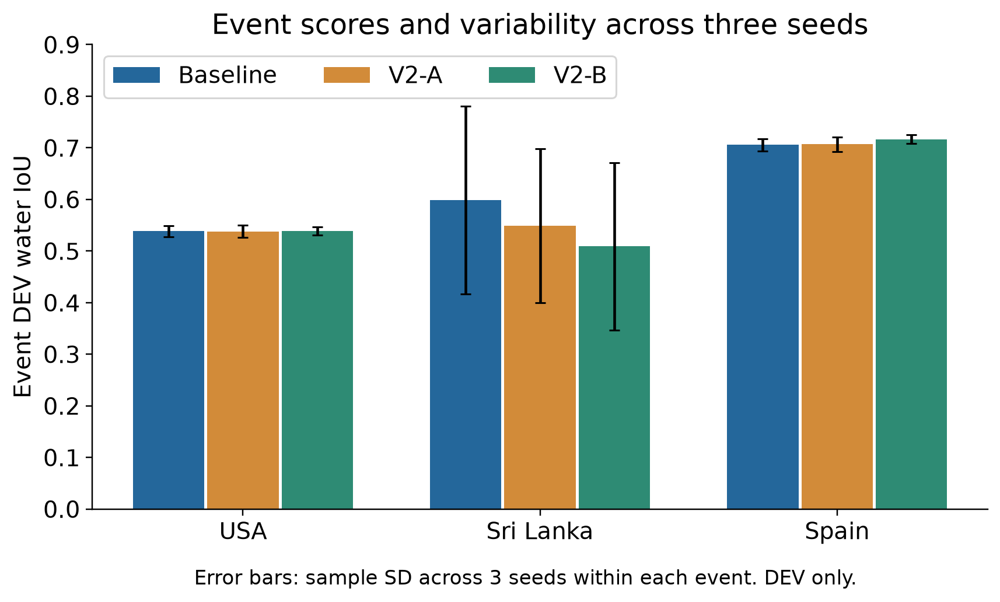
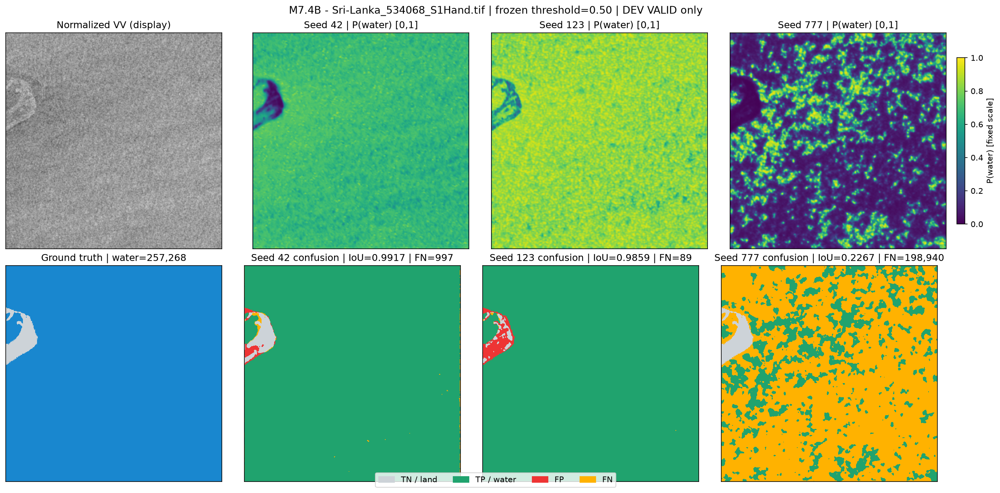
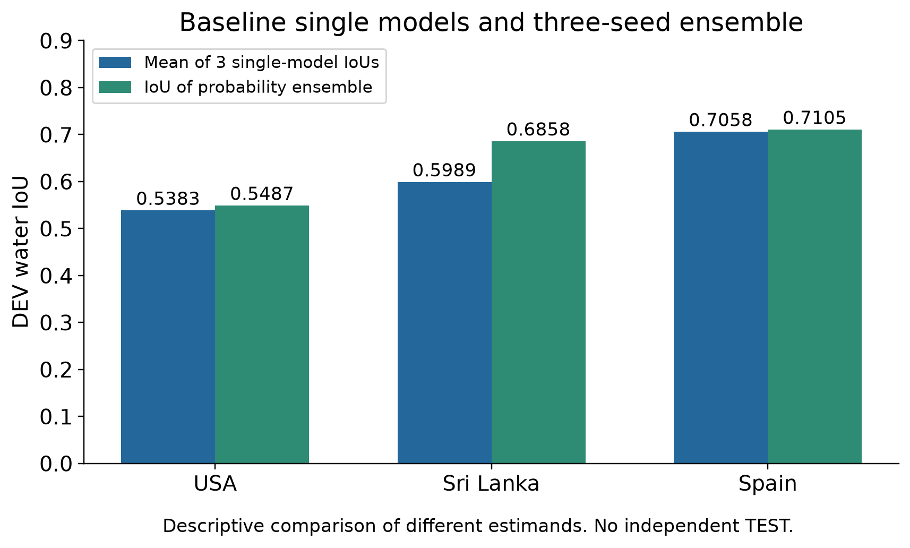
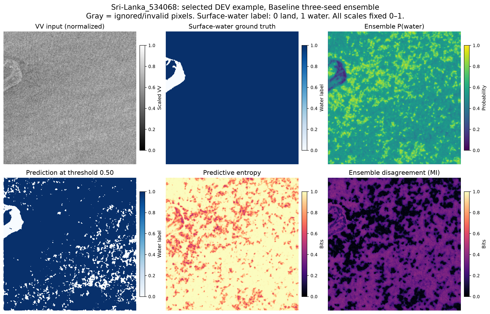
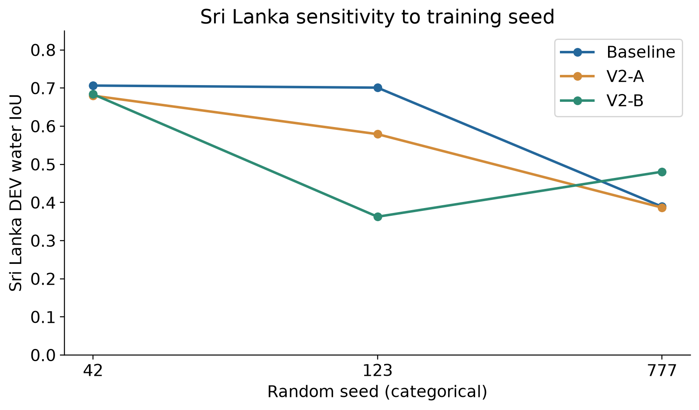
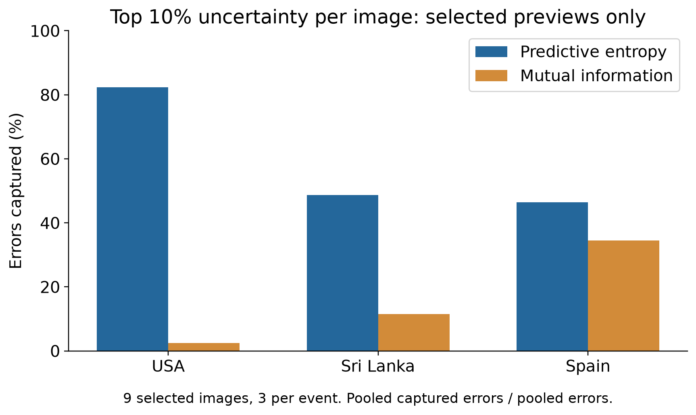

# FloodAI-Research: เนื้อหานำเสนอฉบับรวม

[แผนเรื่อง](slides/00_storyline_TH.md) · [วิธีใช้](README_TH.md)

---

# 01 การทำแผนที่น้ำผิวดินข้ามเหตุการณ์ด้วย SAR

ประเภท: สไลด์หลัก · เวลาแนะนำ: 25 วินาที

## ประเด็นที่ต้องการให้ผู้ฟังเข้าใจ

ตั้งขอบเขตงานให้ชัดตั้งแต่หน้าแรก

## ข้อความบนสไลด์

**Domain Generalization and Uncertainty Quantification for SAR Surface-Water Mapping**

Sentinel-1 VV/VH และ Small U-Net

ผลการทดลองเบื้องต้นบน Event-disjoint Development Validation

[ชื่อผู้จัดทำ] · [รหัสนักศึกษา] · 19 พฤศจิกายน 2569

## บทพูดภาษาไทย

งานนี้ศึกษาความน่าเชื่อถือของการจำแนกน้ำผิวดินจากภาพดาวเทียม SAR โดยดูว่าผลเปลี่ยนไปอย่างไรเมื่อกันเหตุการณ์หนึ่งออกจากการฝึก และการรวมโมเดลหลาย seeds ช่วยให้เราวิเคราะห์ผลทำนายและความไม่แน่นอนได้อย่างไร วันนี้นำเสนอผลในขั้นพัฒนา ซึ่งยังต้องยืนยันด้วยชุดทดสอบอิสระต่อไป

## ภาพหรือตารางและการจัดวาง

ใช้ชื่อเรื่องและข้อความสั้น ๆ ไม่มีความจำเป็นต้องใส่ภาพผลทดลองบนหน้าปก

## หลักฐานสำหรับผู้จัดทำ

Claim IDs: C01, C03

- [โค้ดโมเดลและอินพุต](../train_sar_unet.py)
- [Protocol ที่บันทึกไว้](../results/event_level_v2/m70d_protocol_freeze/m70d_frozen_protocol.json)

## ขอบเขตการตีความ

วันที่นำเสนอมาจากบริบทของผู้ใช้ ชื่อและรหัสต้องกรอกก่อนจัดสไลด์

---

# 02 โจทย์และคำถามวิจัย

ประเภท: สไลด์หลัก · เวลาแนะนำ: 65 วินาที

## ประเด็นที่ต้องการให้ผู้ฟังเข้าใจ

ผู้ฟังต้องรู้ว่าอินพุตคืออะไร Ground Truth หมายถึงอะไร และงานกำลังตอบคำถามใด

## ข้อความบนสไลด์

- อินพุต: Sentinel-1 SAR สองแบนด์ VV และ VH
- เป้าหมาย: ความน่าจะเป็นของน้ำผิวดินรายพิกเซล ณ เวลาถ่ายภาพ
- คำถาม: Sampling ช่วยเพิ่มคะแนนข้ามเหตุการณ์หรือไม่ และผลไวต่อ seed เพียงใด?
- คำถามต่อเนื่อง: Ensemble และ UQ ช่วยบอกพฤติกรรมที่ควรตรวจเพิ่มได้อย่างไร?

## บทพูดภาษาไทย

ตัวอย่างนี้แสดง VV, VH และป้ายกำกับน้ำในภาพเดียวกัน เราฝึกให้โมเดลสร้าง P(water) รายพิกเซล ซึ่งอาจรวมทั้งน้ำถาวรและน้ำที่เกิดระหว่างเหตุการณ์ งานปัจจุบันใช้ SAR สองแบนด์เท่านั้น การประเมินจึงมุ่งที่การจำแนกน้ำในภาพ ส่วนการพยากรณ์ล่วงหน้าต้องมีโจทย์และข้อมูลเพิ่มเติม เมื่อเปลี่ยนเหตุการณ์ ภูมิประเทศและลักษณะภาพอาจต่างไป เราจึงตรวจทั้งคะแนน ความผันผวนจากการฝึก และความไม่แน่นอนของผลทำนาย

## ภาพหรือตารางและการจัดวาง

ใช้ภาพ VV/VH/GT เต็มความกว้างด้านล่าง เก็บคำถามวิจัยไว้ด้านบน ภาพคือ Sri-Lanka_713926 จาก DEV

## หลักฐานสำหรับผู้จัดทำ

Claim IDs: C01, C02

- [ตัวอ่านอินพุตและ labels](../train_sar_unet.py)
- [ตัวเลขและ metadata ของ raster](evidence/verified_rasters.csv)
- [ข้อมูลชุดข้อมูลจากผู้จัดทำ](https://github.com/cloudtostreet/Sen1Floods11)

## ขอบเขตการตีความ

อย่าเรียก Ground Truth ว่าแผนที่น้ำท่วมเกิดใหม่ทั้งหมด และอย่าอ้างการพยากรณ์อนาคต

---

# 03 ข้อมูลและการแบ่งตามเหตุการณ์

ประเภท: สไลด์หลัก · เวลาแนะนำ: 75 วินาที

## ประเด็นที่ต้องการให้ผู้ฟังเข้าใจ

243 ภาพคือคลังพัฒนา แต่ละโมเดลฝึกด้วยจำนวนภาพตาม fold

## ข้อความบนสไลด์

**Sen1Floods11: 243 คู่ SAR/LabelHand จาก 7 event prefixes**

| Validation event | TRAIN | VALID |
| --- | ---: | ---: |
| USA | 174 | 69 |
| Sri Lanka | 201 | 42 |
| Spain | 213 | 30 |

กัน Validation event ออกจาก TRAIN ทั้งเหตุการณ์

ใช้ VALID เลือก checkpoint และเปรียบเทียบวิธี จึงรายงานเป็น Development Results

## บทพูดภาษาไทย

ชุดพัฒนามี Mekong 30, Nigeria 18, Pakistan 28, Somalia 26, Spain 30, Sri Lanka 42 และ USA 69 ภาพ แต่เราไม่ได้ฝึกทุกโมเดลด้วย 243 ภาพ ตัวอย่าง fold ของ Sri Lanka ฝึกด้วยอีกหกเหตุการณ์ 201 ภาพ แล้วใช้ Sri Lanka ทั้ง 42 ภาพเป็น Validation วิธีนี้ตรวจเหตุการณ์ที่ไม่ได้อยู่ใน TRAIN ของโมเดลนั้น อย่างไรก็ตาม เราใช้ Validation เลือก epoch และพัฒนาวิธีด้วย จึงยังเรียกเป็น Independent Final Test ไม่ได้ India, Paraguay, Ghana และ Bolivia ไม่อยู่ในคลังพัฒนา V2 นี้

## ภาพหรือตารางและการจัดวาง

ใช้ตาราง TRAIN/VALID เป็นภาพหลัก ไม่จำเป็นต้องเพิ่มแผนที่ประเทศ ตารางสำรองจำนวนภาพราย event อยู่ Appendix D

## หลักฐานสำหรับผู้จัดทำ

Claim IDs: C03, C04, C05

- [Split ที่ตรวจแล้ว](evidence/verified_splits.csv)
- [CSV ต้นทางของ fold USA](../data/sen1floods11/v2_development_roots/dev_fold_01_usa/splits/flood_train_data.csv)
- [รายงานตรวจ raster ทุกคู่](evidence/verified_rasters.csv)

## ขอบเขตการตีความ

เป็น 3 held-out validation events จาก 7 events ไม่ใช่ leave-one-event-out ครบ 7 folds และไม่ใช่ 243 independent events

---

# 04 Small U-Net ที่ใช้จริง

ประเภท: สไลด์หลัก · เวลาแนะนำ: 60 วินาที

## ประเด็นที่ต้องการให้ผู้ฟังเข้าใจ

แสดงสถาปัตยกรรมจากโค้ดที่ฝึกจริง และสิ่งที่คงที่ระหว่างวิธี

## ข้อความบนสไลด์

| ส่วนของโมเดล | Channels |
| --- | --- |
| Input | 2: VV, VH |
| Encoder | 16, 32, 64, 128 |
| Bottleneck | 256 |
| Decoder พร้อม Skip connections | 128, 64, 32, 16 |
| Output | 1 logit ต่อพิกเซล |

**1,963,953 parameters** · Sigmoid เป็น P(water) · Threshold 0.50

TRAIN crop 256×256 · VALID ใช้ภาพเต็ม 512×512

## บทพูดภาษาไทย

ทั้งสามวิธีใช้ Small U-Net เดียวกัน Encoder ลดขนาดภาพเพื่อเรียนรู้บริบท ส่วน Decoder เพิ่มความละเอียดและรวม skip features เพื่อคืนตำแหน่งเชิงพื้นที่ โค้ดนี้ใช้ Convolution, GroupNorm และ ReLU โดยเพิ่มขนาดด้วย bilinear interpolation แล้วต่อกับ features ของ Encoder ทั้ง 27 runs ใช้โครงสร้างและจำนวนพารามิเตอร์เดียวกัน Output เป็น logit แล้วใช้ sigmoid และ threshold คงที่ 0.50

## ภาพหรือตารางและการจัดวาง

ใช้ตาราง channels เป็นหลัก หากวาดแผนภาพภายหลัง ให้ยึดรายละเอียดจากตารางนี้และโค้ด SmallUNet ไม่ใช้แผนภาพ U-Net ต้นฉบับแทนโมเดลจริง

## หลักฐานสำหรับผู้จัดทำ

Claim IDs: C06, C07

- [SmallUNet, conv_block และ decode](../train_sar_unet.py)
- [พารามิเตอร์และ checkpoint ที่ตรวจแล้ว](evidence/verified_runs.csv)
- [แนวคิด U-Net ต้นฉบับ](https://arxiv.org/abs/1505.04597)

## ขอบเขตการตีความ

Small U-Net เป็น implementation ของโปรเจ็กต์นี้ รายละเอียด channels, normalization และ upsampling ต่างจาก U-Net ต้นฉบับ

---

# 05 วิธีเลือกภาพระหว่างฝึก

ประเภท: สไลด์หลัก · เวลาแนะนำ: 75 วินาที

## ประเด็นที่ต้องการให้ผู้ฟังเข้าใจ

ความต่างที่ตั้งใจทดลองอยู่ที่ TRAIN image sampling

## ข้อความบนสไลด์

| วิธี | การเลือกภาพ TRAIN |
| --- | --- |
| Baseline | Shuffle โดยไม่เลือกภาพซ้ำภายใน epoch |
| V2-A | ถ่วงโอกาสให้แต่ละ event เท่ากันในความคาดหมาย |
| V2-B | ผสม uniform-image 50% กับ uniform-coverage-bin 50% |

V2-A และ V2-B สุ่มแบบคืนตัวอย่าง จำนวนครั้งต่อ epoch เท่ากับ N_train

ทั้งสามวิธีใช้ architecture, loss, folds และ threshold หลักเหมือนกัน

## บทพูดภาษาไทย

Baseline ให้ภาพแต่ละภาพผ่านการเลือกหนึ่งครั้งต่อ epoch แต่แต่ละภาพยังได้รับ crop และ augmentation ใหม่ V2-A ให้แต่ละ event มีมวลความน่าจะเป็นเท่ากัน โดยไม่ได้บังคับจำนวนภาพที่สุ่มได้จริงให้เท่ากันทุก epoch ส่วน V2-B ใช้สัดส่วนน้ำจาก full-chip Ground Truth ของ TRAIN จัดห้ากลุ่ม และผสมการสุ่มสองแบบครึ่งต่อครึ่ง จึงไม่ได้ทำให้ห้ากลุ่มมีมวลเท่ากันทั้งหมด ทั้งสองแบบเลือกภาพซ้ำได้ ต่างจาก Baseline เราจึงตีความผลเป็นผลของ sampling policy ทั้งชุด รวมถึง replacement ด้วย

## ภาพหรือตารางและการจัดวาง

ใช้ตารางเปรียบเทียบสามแถว สูตรและขอบเขตห้ากลุ่มอยู่ Appendix A

## หลักฐานสำหรับผู้จัดทำ

Claim IDs: C08, C09, C10

- [Baseline DataLoader](../train_sar_unet.py)
- [calculate_weights และ TrackedBalancedSampler](../train_v2a_eventbalanced.py)
- [water_bin และ probability_for_bin](../m76b_water_sampler.py)
- [ตรวจ sampling weights จาก TRAIN จริง](evidence/verified_coverage_bins.csv)

## ขอบเขตการตีความ

กลุ่มของ V2-B เป็น full-chip coverage ไม่ใช่ coverage ของ crop และการใช้ seed เดียวกันไม่ทำให้ augmentation/exposure เหมือนกันทุกวิธี

---

# 06 การทดลองและเกณฑ์เปรียบเทียบ

ประเภท: สไลด์หลัก · เวลาแนะนำ: 60 วินาที

## ประเด็นที่ต้องการให้ผู้ฟังเข้าใจ

บอกจำนวนการฝึก หน่วยวัด และลำดับการเฉลี่ยให้ชัด

## ข้อความบนสไลด์

**3 วิธี × 3 seeds × 3 folds = 27 runs**

Seeds: 42, 123, 777

1. ภายในแต่ละ event: รวม TP, FP, FN ของ valid pixels แล้วคำนวณ Water IoU
2. ภายในแต่ละ seed: เฉลี่ย IoU ของสาม Validation events แบบให้น้ำหนักเท่ากัน
3. รายงานค่าเฉลี่ยและ Sample SD ข้ามสาม seed macro scores

เลือก checkpoint จาก VALID IoU · Threshold คงที่ 0.50

## บทพูดภาษาไทย

คะแนนหลักมีสองระดับการรวม ภายในเหตุการณ์เราใช้ confusion counts รวมทุกภาพ ไม่ได้เฉลี่ย IoU รายภาพ จากนั้นเฉลี่ยสามเหตุการณ์โดยให้น้ำหนักเหตุการณ์เท่ากัน แล้วเฉลี่ยอีกครั้งข้าม seeds Error bars ที่จะแสดงคือ Sample SD ของ seed macro scores สามค่า ไม่ใช่ confidence interval จากเหตุการณ์จำนวนมาก ในโค้ด checkpoint จะอัปเดตเมื่อ VALID IoU ดีขึ้นเกิน 0.00001 และหยุดเมื่อไม่ดีขึ้นหก epochs หรือครบ 25 epochs

## ภาพหรือตารางและการจัดวาง

ใช้สมการ IoU = TP/(TP+FP+FN) หนึ่งบรรทัดคู่กับขั้นตอนการเฉลี่ย ไม่ต้องใส่ loss curves บนหน้านี้

## หลักฐานสำหรับผู้จัดทำ

Claim IDs: C07, C11, C12

- [คะแนนและ epoch ของ 27 runs](evidence/verified_runs.csv)
- [Seed macro scores](evidence/verified_seed_macros.csv)
- [evaluate และ checkpoint update](../train_sar_unet.py)

## ขอบเขตการตีความ

IoU 0.6143 ไม่ใช่ Accuracy 61.43% จำนวน seeds เป็นการฝึกซ้ำ ไม่ใช่จำนวนพื้นที่อิสระ

---

# 07 Sampling ทั้งสองแบบยังไม่เพิ่มคะแนนรวม

ประเภท: สไลด์หลัก · เวลาแนะนำ: 70 วินาที

## ประเด็นที่ต้องการให้ผู้ฟังเข้าใจ

ตอบคำถามวิจัยข้อแรกด้วยผลจริง แม้ว่าวิธีใหม่จะไม่ชนะ

## ข้อความบนสไลด์

| วิธี | Macro DEV IoU | SD ข้าม seed macros | ผลต่างจาก Baseline |
| --- | --- | --- | --- |
| Baseline | 0.6143 | 0.0576 | +0.0000 |
| V2-A | 0.5979 | 0.0457 | -0.0164 |
| V2-B | 0.5879 | 0.0488 | -0.0264 |

Baseline มีค่าเฉลี่ยสูงสุดในสามวิธีที่ทดลอง

Error bars: Sample SD ของ 3 seed macro scores

## บทพูดภาษาไทย

ภายใต้ข้อมูลและโปรโตคอลนี้ Baseline ได้ค่าเฉลี่ยสูงสุด V2-A ต่ำกว่าประมาณ 0.0164 IoU points และ V2-B ต่ำกว่าประมาณ 0.0264 IoU points ผลนี้ยังไม่สนับสนุนว่าการปรับ sampling สองแบบช่วยเพิ่มคะแนนรวม เรารายงานผลตามที่ได้ และยังไม่สรุปว่าวิธีเหล่านี้ใช้ไม่ได้ในข้อมูลหรือเงื่อนไขอื่น การทดลองนี้ไม่ได้ทำการทดสอบนัยสำคัญทางสถิติ

## ภาพหรือตารางและการจัดวาง

ใช้กราฟเป็นภาพหลัก ตารางเป็นตัวเลขสำหรับนำไปทำ native chart หรือเก็บไว้ใน notes ไม่จำเป็นต้องแสดงซ้ำทั้งตารางและกราฟเต็มหน้า

## หลักฐานสำหรับผู้จัดทำ

Claim IDs: C13

- [คำนวณใหม่จาก checkpoint/history](evidence/verified_models.csv)
- [หลักฐานราย run](evidence/verified_runs.csv)
- [ที่มากราฟ](assets/figure_sources.csv)

## ขอบเขตการตีความ

กล่าวได้ว่า Baseline มี mean สูงสุดใน DEV นี้ หลีกเลี่ยงคำว่าเหนือกว่าอย่างมีนัยสำคัญหรือแก้ DG ได้สำเร็จ

---

# 08 คะแนนและความผันผวนต่างกันตามเหตุการณ์

ประเภท: สไลด์หลัก · เวลาแนะนำ: 70 วินาที

## ประเด็นที่ต้องการให้ผู้ฟังเข้าใจ

ค่าเฉลี่ยรวมอาจซ่อนความไม่เสถียรของบางพื้นที่

## ข้อความบนสไลด์

| DEV event | Baseline | V2-A | V2-B |
| --- | --- | --- | --- |
| USA | 0.5383 | 0.5381 | 0.5384 |
| Sri Lanka | 0.5989 | 0.5486 | 0.5090 |
| Spain | 0.7058 | 0.7071 | 0.7164 |

Sri Lanka มีความผันผวนข้าม seeds สูง

Baseline Sri Lanka: 0.7065 / 0.7011 / 0.3891

## บทพูดภาษาไทย

เมื่อแยกตามพื้นที่ USA มีค่าใกล้กันทั้งสามวิธี Spain ดีขึ้นเล็กน้อยใน V2-B แต่ Sri Lanka มีความผันผวนสูง Baseline seed 42 และ 123 ได้ใกล้ 0.70 ขณะที่ seed 777 เหลือประมาณ 0.39 วิธี V2-B ช่วย seed 777 แต่ทำให้ seed 123 ลดลงมาก จึงยังอ้างว่าแก้ความไม่เสถียรได้สม่ำเสมอไม่ได้ คะแนนในกราฟเป็น mean ข้าม seeds และ error bars เป็น Sample SD ภายใน event

## ภาพหรือตารางและการจัดวาง

ใช้กราฟแยก event หนึ่งภาพ พร้อมข้อความ seed scores ของ Sri Lanka สั้น ๆ หากผู้ฟังถามเปิด Appendix B ดูทุก seed

## หลักฐานสำหรับผู้จัดทำ

Claim IDs: C14

- [คะแนนเฉลี่ยราย event](evidence/verified_events.csv)
- [คะแนนทุก seed](evidence/verified_runs.csv)

## ขอบเขตการตีความ

ความต่างระหว่างประเทศปนกับเหตุการณ์ สภาพภาพและโมเดลที่ฝึกต่างกัน ไม่ใช่การประมาณผลเชิงสาเหตุของประเทศ

---

# 09 ตัวอย่างการพลาดน้ำใน Sri Lanka

ประเภท: สไลด์หลัก · เวลาแนะนำ: 65 วินาที

## ประเด็นที่ต้องการให้ผู้ฟังเข้าใจ

ให้ผู้ฟังเห็นว่าความต่างข้าม seed แสดงออกเชิงพื้นที่อย่างไร

## ข้อความบนสไลด์

**ภาพ Sri-Lanka_534068**

Ground Truth มีน้ำ 98.14% ของ valid pixels

| Seed | IoU ของภาพนี้ |
| --- | --- |
| 42 | 0.9917 |
| 123 | 0.9859 |
| 777 | 0.2267 |

Seed 777 พลาดพื้นที่น้ำจำนวนมากในภาพตัวอย่างนี้

## บทพูดภาษาไทย

ในภาพนี้มีน้ำเกือบเต็มภาพ Seed 42 และ 123 ตรวจน้ำได้เกือบทั้งหมด แต่ seed 777 ให้ P(water) ต่ำในบริเวณกว้าง สีส้มใน confusion map คือ False Negative ซึ่งเป็นพิกเซลน้ำที่โมเดลทำนายว่าไม่มีน้ำ ภาพนี้ช่วยให้เห็นปัญหาที่คะแนนรวมเพียงค่าเดียวอธิบายไม่ครบ และเป็นหนึ่งในหลักฐานที่นำไปสู่การทดลอง water-coverage sampling อย่างไรก็ตาม ภาพตัวอย่างนี้ไม่ได้พิสูจน์ว่าความไม่สมดุลของสัดส่วนน้ำเป็นสาเหตุทั้งหมด

## ภาพหรือตารางและการจัดวาง

ใช้ภาพเปรียบเทียบเดิมทั้งภาพ รักษา legend ของ TP/FP/FN ไว้ เก็บตาราง IoU เป็น notes หากพื้นที่สไลด์ไม่พอ

## หลักฐานสำหรับผู้จัดทำ

Claim IDs: C15

- [ตารางกรณีตัวอย่างที่ตรวจแล้ว](evidence/verified_high_water_cases.csv)
- [ต้นฉบับภาพ](../results/event_level_v2/m74b_high_water_diagnostics/m74b_Sri-Lanka_534068_comparison.png)

## ขอบเขตการตีความ

เป็น selected DEV case ห้ามอ้างว่าเป็นพฤติกรรมของทุกภาพหรือเป็นหลักฐานสาเหตุเพียงอย่างเดียว

---

# 10 ผลของ Baseline Deep Ensemble

ประเภท: สไลด์หลัก · เวลาแนะนำ: 75 วินาที

## ประเด็นที่ต้องการให้ผู้ฟังเข้าใจ

การเฉลี่ย probability จากโมเดลที่ฝึกคนละ seed ให้ผล DEV อีกแบบหนึ่ง

## ข้อความบนสไลด์

เฉลี่ย P(water) จาก Baseline seeds 42, 123, 777 ภายใน fold เดียวกัน ก่อน threshold 0.50

| DEV event | Mean single-model IoU | Ensemble IoU |
| --- | --- | --- |
| USA | 0.5383 | 0.5487 |
| Sri Lanka | 0.5989 | 0.6858 |
| Spain | 0.7058 | 0.7105 |

**Macro DEV Ensemble IoU = 0.6483**

เทียบ Mean single-model Macro IoU = 0.6143 · ผลต่าง +0.0340 IoU points

## บทพูดภาษาไทย

เราใช้ Baseline สามโมเดลของแต่ละ fold มารวม probability รายพิกเซล แล้ว threshold ทีเดียว ไม่ได้รวมสาม sampling methods และไม่ได้รวมโมเดลข้าม folds ซึ่งอาจทำให้ภาพของเหตุการณ์นั้นเคยอยู่ใน TRAIN ของสมาชิกบางตัว Ensemble ให้ Macro DEV IoU สูงกว่าค่าเฉลี่ยโมเดลเดี่ยวในการเปรียบเทียบนี้ โดยผลต่างเด่นที่สุดใน Sri Lanka แต่ค่าเฉลี่ยคะแนนโมเดลเดี่ยวกับคะแนนของ probability ensemble เป็นการสรุปคนละแบบ และใช้ DEV ที่ผ่านการเลือก checkpoint แล้ว จึงยังต้องทดสอบอิสระต่อไป

## ภาพหรือตารางและการจัดวาง

กราฟเปรียบเทียบราย event พร้อมตัวเลข macro ด้านบน ระบุ Mean single-model กับ Ensemble ให้ตรงกัน

## หลักฐานสำหรับผู้จัดทำ

Claim IDs: C16, C17

- [ผล Ensemble ที่ตรวจการรวมใหม่](evidence/verified_ensemble_events.csv)
- [สมาชิกและ SHA-256](../results/event_level_v2/m80a_dev_ensemble_uq/m80a_members.csv)
- [การทำนายซ้ำเก้าภาพบน CPU](evidence/cpu_preview_recheck.csv)
- [Deep Ensembles ต้นฉบับ](https://papers.neurips.cc/paper/2017/hash/9ef2ed4b7fd2c810847ffa5fa85bce38-Abstract.html)

## ขอบเขตการตีความ

การประเมินมี Ensemble แยกตาม fold สามชุด ไม่ใช่ Ensemble 9 โมเดลชุดเดียว และไม่ใช่การพิสูจน์ผลบน Independent TEST

---

# 11 แผนที่ความไม่แน่นอนของ Ensemble

ประเภท: สไลด์หลัก · เวลาแนะนำ: 80 วินาที

## ประเด็นที่ต้องการให้ผู้ฟังเข้าใจ

อธิบายว่า Entropy กับ MI บอกอะไร และเหตุใด uncertainty ต่ำจึงยังผิดได้

## ข้อความบนสไลด์

- Predictive Entropy: ความไม่แน่นอนของ probability เฉลี่ย
- Mutual Information: ความเห็นต่างของสมาชิก Ensemble
- ผลระดับภาพครอบคลุม 141 DEV chips
- การตรวจจับข้อผิดพลาดระดับพิกเซลอย่างละเอียดมีเพียง 9 ภาพที่คัดเลือกไว้

สมาชิกอาจทำนายผิดไปทางเดียวกันและให้ MI ต่ำได้

## บทพูดภาษาไทย

ภาพหกช่องนี้แสดง SAR, Ground Truth, probability เฉลี่ย, binary prediction, predictive entropy และ MI ตามลำดับ Entropy สูงเมื่อ probability ใกล้ 0.5 ส่วน MI สะท้อนว่าผลของสมาชิกต่างกันเพียงใด เราสร้างผลระดับภาพครบ 141 ภาพ แต่เก็บ arrays สำหรับการตรวจ pixel-level แบบละเอียดไว้เพียงเก้าภาพที่เลือก จึงต้องแยกขอบเขตสองส่วนนี้ ข้อมูล UQ ใช้ช่วยวิเคราะห์และจัดลำดับการตรวจเพิ่มได้ แต่ค่า uncertainty ต่ำยังไม่รับประกันว่าคำทำนายถูกต้อง

## ภาพหรือตารางและการจัดวาง

ใช้ภาพหกช่องเต็มความกว้าง ระบุ Selected Sri Lanka DEV example และใช้พื้นที่ข้อความเพียงเล็กน้อย ตาราง UQ และการจับ error อยู่ Appendix C

## หลักฐานสำหรับผู้จัดทำ

Claim IDs: C18, C19, C20

- [ผล UQ ทั้งสาม event](evidence/verified_ensemble_events.csv)
- [คำนวณ error capture จาก arrays ใหม่](evidence/verified_selected_uq_events.csv)
- [สูตร uncertainty ในโค้ด](../m80a_dev_ensemble_uq.py)

## ขอบเขตการตีความ

MI เป็น ensemble disagreement proxy หลีกเลี่ยงการเรียกว่าแยก epistemic/aleatoric uncertainty ได้สมบูรณ์ หรือรับรองความปลอดภัยในการตัดสินใจ

---

# 12 ข้อค้นพบและสิ่งที่ต้องยืนยันต่อ

ประเภท: สไลด์หลัก · เวลาแนะนำ: 55 วินาที

## ประเด็นที่ต้องการให้ผู้ฟังเข้าใจ

ปิดด้วยคำตอบของงานวิจัยและขอบเขตที่ตรวจแล้ว

## ข้อความบนสไลด์

- Baseline มี Macro DEV IoU สูงสุดในสาม sampling methods: **0.6143**
- Sri Lanka แสดงความไวต่อ seed และการพลาดน้ำในบางภาพ
- Baseline Ensemble ให้ Macro DEV IoU **0.6483** และสร้างแผนที่ UQ ได้
- ผลปัจจุบันเป็น Development Results จากสาม Validation events

**ขั้นถัดไป:** Independent labelled events และ Ground Truth ประเทศไทยที่สอดคล้องด้านเวลาและนิยาม

## บทพูดภาษาไทย

ข้อค้นพบหลักคือการเปลี่ยน sampling ที่ทดลองยังไม่เพิ่มคะแนนรวม และความเสถียรของการฝึกเป็นปัญหาที่เห็นชัดใน Sri Lanka การรวม Baseline หลาย seeds ให้คะแนน DEV สูงขึ้นในการเปรียบเทียบเชิงพรรณนาและทำให้วิเคราะห์ uncertainty ได้ งานต่อไปคือยืนยันโมเดลบนเหตุการณ์ที่ยังไม่เคยใช้ตัดสินใจ พร้อมพัฒนา Ground Truth ประเทศไทยที่เทียบกับเป้าหมาย surface water ได้ ส่วนพิมายในตอนนี้มีบทบาทเป็น diagnostic pilot เราจึงยังไม่รายงานตัวเลขเป็น Thailand Water IoU หรืออ้างการใช้งานครอบคลุมประเทศไทย

## ภาพหรือตารางและการจัดวาง

ใช้ข้อความข้อค้นพบสั้น ๆ และงานต่อไป ไม่ต้องนำกราฟผลทั้งหมดมาแสดงซ้ำ

## หลักฐานสำหรับผู้จัดทำ

Claim IDs: C13, C14, C17, C21, C22

- [ผลการตรวจหลักฐาน](evidence/verification_report_TH.md)
- [ประเด็นที่ยังไม่ยืนยัน](evidence/unresolved_questions_TH.md)

## ขอบเขตการตีความ

คุณค่าของการประยุกต์ใช้เป็นศักยภาพที่ต้องศึกษาต่อ ยังไม่มีการวัดผลประโยชน์ทางเศรษฐกิจหรือความพร้อมใช้งานจริง

---

# Appendix A รายละเอียดการฝึกและ Sampling

ประเภท: สไลด์สำรอง · เวลาแนะนำ: 60 วินาที

## ประเด็นที่ต้องการให้ผู้ฟังเข้าใจ

เตรียมตอบคำถามด้าน implementation โดยไม่ทำให้สไลด์หลักแน่น

## ข้อความบนสไลด์

| รายการ | ค่าที่ใช้ |
| --- | --- |
| Loss | 0.5 masked BCE + 0.5 soft Dice |
| Optimizer | AdamW, lr 0.0003, weight decay 0.0001 |
| Batch / Max epochs / Patience | 2 / 25 / 6 |
| TRAIN augmentation | Crop 256, H/V flips, rotations 0/90/180/270° |
| VALID | ภาพเต็ม 512, ไม่มี augmentation |
| Normalization preset | VV [−35,5], VH [−40,0], clip แล้ว scale [0,1] |
| Valid pixels | Label ≠ −1 และ SAR ผ่าน finite/nodata mask |

V2-A: P(image i) = 1/(K_events × N_event(i))

V2-B: P(image i) = 0.5/N_train + 0.5/(5 × N_bin(i))

ห้ากลุ่ม V2-B: f=0, 0<f<0.01, 0.01≤f<0.10, 0.10≤f<0.50, 0.50≤f≤1

## บทพูดภาษาไทย

โค้ดใช้ LabelHand −1 เป็น ignore, 0 เป็น land และ 1 เป็น water โดยไม่ใช้ label nodata=0 มาตัด land ทิ้ง แต่ยังใช้ nodata metadata ของ SAR ตรวจ invalid pixels ส่วนช่วง normalization เป็น preset ตามข้อมูลที่เอกสารชุดข้อมูลระบุว่าเป็น dB ตรวจพบชื่อแบนด์ VV/VH ใน TIFF ทุกคู่ที่ใช้ และมี sign-off การตรวจ provenance ที่บันทึกไว้ แต่ metadata หน่วยของ TIFF เองว่าง จึงไม่ควรกล่าวว่าได้ตรวจเทียบกระบวนการ radiometric processing ต้นทางทั้งหมดอย่างอิสระแล้ว

## ภาพหรือตารางและการจัดวาง

ตารางใช้เป็นหน้าสำรอง สามารถแยกสองหน้าถ้าต้องอธิบาย sampler ละเอียด

## หลักฐานสำหรับผู้จัดทำ

Claim IDs: C06, C07, C08, C09, C10, C23

- [โค้ดฝึก](../train_sar_unet.py)
- [สูตร sampling](../m76b_water_sampler.py)
- [configs และ checkpoint ทุก run](evidence/verified_runs.csv)
- [TIFF metadata](evidence/verified_rasters.csv)

## ขอบเขตการตีความ

การแบ่ง bin ใช้สัดส่วนน้ำใน full chip ของ TRAIN เท่านั้น จำนวนภาพที่เลือกได้จริงอาจไม่ตรงสัดส่วนคาดหมายทุก epoch

---

# Appendix B คะแนนครบ 27 Runs

ประเภท: สไลด์สำรอง · เวลาแนะนำ: 50 วินาที

## ประเด็นที่ต้องการให้ผู้ฟังเข้าใจ

ข้อมูลสำรองสำหรับตรวจว่า mean ซ่อนพฤติกรรม seed ใดไว้

## ข้อความบนสไลด์

| Method | Seed | USA | Sri Lanka | Spain |
| --- | --- | --- | --- | --- |
| Baseline | 42 | 0.5289 | 0.7065 | 0.6940 |
| Baseline | 123 | 0.5367 | 0.7011 | 0.7176 |
| Baseline | 777 | 0.5494 | 0.3891 | 0.7057 |
| V2-A | 42 | 0.5442 | 0.6801 | 0.6910 |
| V2-A | 123 | 0.5247 | 0.5792 | 0.7170 |
| V2-A | 777 | 0.5452 | 0.3866 | 0.7132 |
| V2-B | 42 | 0.5292 | 0.6839 | 0.7068 |
| V2-B | 123 | 0.5434 | 0.3626 | 0.7231 |
| V2-B | 777 | 0.5426 | 0.4806 | 0.7192 |

## บทพูดภาษาไทย

แต่ละช่องคือ event-level pixel-micro Water IoU จาก checkpoint ของ fold และ seed นั้น ทุก checkpoint ผ่านการเทียบกับ history, epoch, threshold, seed, counts และสถาปัตยกรรมในรอบตรวจนี้ กราฟเส้นแสดง Sri Lanka เพื่อให้เห็นว่าการเปลี่ยน sampling ช่วยและทำให้แย่ลงต่างกันในแต่ละ seed

## ภาพหรือตารางและการจัดวาง

ใช้ตารางหรือกราฟอย่างใดอย่างหนึ่งต่อหน้า หากต้องการดู VALID IoU/Recall/Precision/Loss ตาม epoch ให้เปิดภาพ 06_sri_lanka_learning_curves.png จาก assets

## หลักฐานสำหรับผู้จัดทำ

Claim IDs: C11, C14, C24

- [verified_runs.csv](evidence/verified_runs.csv)
- [checks.csv](evidence/checks.csv)

## ขอบเขตการตีความ

Seed เป็นหมวดหมู่ เส้นเชื่อมในกราฟใช้ติดตามวิธีเดียวกัน ไม่สื่อความสัมพันธ์ต่อเนื่องตามค่า seed

---

# Appendix C ขอบเขตและผลเชิงตัวเลขของ UQ

ประเภท: สไลด์สำรอง · เวลาแนะนำ: 60 วินาที

## ประเด็นที่ต้องการให้ผู้ฟังเข้าใจ

แยกผลทั้ง 141 ภาพออกจากการตรวจจับ error ในเก้าภาพที่เลือก

## ข้อความบนสไลด์

**ผลรวมราย event จาก 141 DEV ภาพ**

| DEV event | Recall | Brier | Entropy (bits) | MI (bits) |
| --- | --- | --- | --- | --- |
| USA | 0.7049 | 0.0420 | 0.6349 | 0.0511 |
| Sri Lanka | 0.7311 | 0.0451 | 0.5180 | 0.0335 |
| Spain | 0.8128 | 0.0338 | 0.2988 | 0.0085 |

**Error detection เฉพาะ 9 selected images**

| พื้นที่ (3 ภาพที่เลือกต่อพื้นที่) | Entropy capture | MI capture |
| --- | --- | --- |
| USA | 82.4% | 2.4% |
| Sri Lanka | 48.7% | 11.5% |
| Spain | 46.4% | 34.5% |

## บทพูดภาษาไทย

Brier และ mean uncertainty ด้านบนรวมทุก valid pixel ของ event ส่วนตารางด้านล่างเลือก 10% ของ valid pixels ที่มี uncertainty สูงที่สุดภายในแต่ละภาพ แล้วนับว่าครอบคลุม FP+FN ได้กี่พิกเซล จากนั้นรวมตัวเศษและตัวส่วนข้ามสามภาพของ event นั้น ตัวเลขนี้ไม่ใช่ precision ของการตรวจ error และไม่ใช่สถิติ error detection ของทั้ง 141 ภาพ ภาพ Sri Lanka บางภาพถูกเลือกจากกรณีศึกษาที่ทราบอยู่ก่อน จึงมี selection bias

## ภาพหรือตารางและการจัดวาง

ตารางสองขอบเขตนี้อาจแยกสองหน้าสำรองได้ แสดงข้อความ Selected 9 only ติดกับกราฟ capture เสมอ

## หลักฐานสำหรับผู้จัดทำ

Claim IDs: C18, C19, C20

- [ผลรวม Ensemble](evidence/verified_ensemble_events.csv)
- [ผลรายภาพที่คัดเลือก](evidence/verified_selected_uq_images.csv)
- [สูตรรวมใหม่](evidence/verified_selected_uq_events.csv)
- [preview_selection ต้นทาง](../m80a_dev_ensemble_uq.py)

## ขอบเขตการตีความ

Brier ต่ำอาจเกิดร่วมกับการตรวจน้ำไม่ครบ ค่า mean entropy ข้าม event ยังขึ้นกับสัดส่วนคลาสและฉาก ไม่ควรใช้จัดอันดับความน่าเชื่อถือโดยลำพัง

---

# Appendix D ที่มาข้อมูลและบทบาทชุดทดสอบ

ประเภท: สไลด์สำรอง · เวลาแนะนำ: 50 วินาที

## ประเด็นที่ต้องการให้ผู้ฟังเข้าใจ

รักษาประวัติการทดลองโดยไม่ปะปนคะแนนต่างโปรโตคอล

## ข้อความบนสไลด์

| กลุ่มข้อมูล | บทบาทในงานปัจจุบัน |
| --- | --- |
| Mekong 30 / Nigeria 18 / Pakistan 28 / Somalia 26 / Spain 30 / Sri Lanka 42 / USA 69 | Development Pool 243 ภาพ |
| USA / Sri Lanka / Spain | Validation events ของสาม folds |
| India / Paraguay / Ghana | Historical TEST ที่เคยตรวจและช่วยกำหนดคำถามวิจัย |
| Bolivia | Holdout เดิมที่เคยตรวจแล้ว |
| Thailand Phimai | Diagnostic pilot ต้องมี aligned surface-water GT เพิ่ม |

Sen1Floods11 ระบุ hand-labelled 446 ภาพ และ weak-labelled 4,385 ภาพในหมวด flood-event data

การทดลอง V2 นี้ใช้ hand-labelled subset 243 คู่

## บทพูดภาษาไทย

เอกสารทางการมีข้อมูลหลายหมวด รวมทั้ง permanent-water data จึงไม่ควรใช้ผลบวก 446 กับ 4,385 แทนจำนวนทุกไฟล์หรือทุกหมวดใน bucket งานนี้ใช้เฉพาะ subset 243 คู่ที่ตรวจแล้ว ตัว prefix Mekong เป็นชื่อไฟล์และไม่ควรถูกตีความว่าเป็น Thailand test เราแยกผลจากช่วงก่อนหน้าไว้เป็นบริบท เพราะฝึกด้วยข้อมูลและ checkpoints ต่างจากการเปรียบเทียบ V2 ปัจจุบัน

## ภาพหรือตารางและการจัดวาง

ใช้ตารางบทบาทข้อมูล ไม่มีความจำเป็นต้องนำคะแนน Historical TEST ขึ้นก่อนผล V2

## หลักฐานสำหรับผู้จัดทำ

Claim IDs: C02, C03, C05, C21, C22, C25

- [Sen1Floods11 docs](https://github.com/cloudtostreet/Sen1Floods11/blob/master/docs/README.md)
- [Protocol](../results/event_level_v2/m70d_protocol_freeze/m70d_frozen_protocol.json)
- [แหล่งอ้างอิงและสถานะตรวจ](evidence/references_TH.md)

## ขอบเขตการตีความ

การแบ่งตาม event prefix ช่วยกันเหตุการณ์ข้าม TRAIN/VALID แต่ไม่ได้พิสูจน์ว่า labels ปราศจากข้อผิดพลาดทุกพิกเซล

---

# Appendix E นิยามเมตริกและความไม่แน่นอน

ประเภท: สไลด์สำรอง · เวลาแนะนำ: 45 วินาที

## ประเด็นที่ต้องการให้ผู้ฟังเข้าใจ

ใช้ตอบคำถามเกี่ยวกับสูตรโดยไม่เพิ่มภาระบนสไลด์หลัก

## ข้อความบนสไลด์

Water IoU = TP / (TP + FP + FN)

Recall = TP / (TP + FN)

P̄ = (P₄₂ + P₁₂₃ + P₇₇₇) / 3

H(P̄) = −P̄ log₂(P̄) − (1−P̄) log₂(1−P̄)

MI = H(P̄) − mean_member H(P_member)

Brier = mean_valid_pixels (P̄ − y)²

IoU เมื่อ union=0 ให้ NaN

Error capture = จำนวน error ใน top-10% uncertainty / จำนวน error ทั้งหมดของภาพที่เลือก

## บทพูดภาษาไทย

Entropy ใช้ฐานสองและมีค่าสูงสุดหนึ่ง bit สำหรับปัญหา binary โค้ด clip ค่า probability เล็กน้อยเพื่อหลีกเลี่ยง log(0) และ clamp MI ที่ติดลบจากความคลาดเคลื่อนเชิงตัวเลขให้เป็นศูนย์ MI วัดความต่างของสมาชิกที่เรามี ไม่ได้พิสูจน์ว่ารู้ uncertainty ทุกแหล่ง เมื่อสมาชิกมั่นใจและผิดตรงกัน ทั้ง Entropy และ MI อาจต่ำได้

## ภาพหรือตารางและการจัดวาง

จัดสูตรเป็นข้อความหรือสมการ editable ภายหลัง ไม่ต้องแปลงเป็นภาพสังเคราะห์

## หลักฐานสำหรับผู้จัดทำ

Claim IDs: C12, C18, C19, C20

- [สูตร evaluate](../train_sar_unet.py)
- [entropy และ uncertainty](../m80a_dev_ensemble_uq.py)
- [top-10% capture](../m80b_dev_uncertainty_audit.py)

## ขอบเขตการตีความ

NaN สำหรับ empty IoU union ไม่ได้หมายความว่าเมตริกทุกตัวในโค้ดใช้ NaN เหมือนกัน เช่น F1 มี policy ของตนเอง

---

# Appendix F เอกสารอ้างอิง

ประเภท: สไลด์สำรอง · เวลาแนะนำ: 25 วินาที

## ประเด็นที่ต้องการให้ผู้ฟังเข้าใจ

แสดงที่มาของข้อมูล แนวคิดโมเดล และ Ensemble

## ข้อความบนสไลด์

- Bonafilia et al. (2020). Sen1Floods11. CVPR Workshops. Dataset repository และ documentation ของผู้จัดทำ
- Ronneberger, Fischer, Brox (2015). U-Net: Convolutional Networks for Biomedical Image Segmentation. arXiv:1505.04597
- Lakshminarayanan, Pritzel, Blundell (2017). Simple and Scalable Predictive Uncertainty Estimation using Deep Ensembles. NeurIPS 30
- ผลโปรเจ็กต์: 27 local histories/checkpoints, V2 split CSVs, M8.0A full DEV outputs และ 9 selected preview arrays

## บทพูดภาษาไทย

งานต้นฉบับสนับสนุนที่มาชุดข้อมูลและแนวคิดของวิธี ส่วนตัวเลขผลวิจัยทั้งหมดมาจากผลรันของโปรเจ็กต์นี้ ไม่มีการนำคะแนนในบทความอื่นมาแทนคะแนนของเรา รายละเอียด URL และขอบเขตที่อ่านยืนยันอยู่ใน references_TH.md

## ภาพหรือตารางและการจัดวาง

ใช้รายการอ้างอิงที่อ่านง่าย ไม่จำเป็นต้องแสดง paths ยาวบนสไลด์

## หลักฐานสำหรับผู้จัดทำ

Claim IDs: C02, C06, C16

- [รายการอ้างอิงพร้อม URL](evidence/references_TH.md)
- [แหล่งไฟล์และ SHA-256](evidence/source_manifest.csv)

## ขอบเขตการตีความ

หน้า paper ของ Sen1Floods11 บน CVF ตอบ 403 ในรอบตรวจนี้ ใช้ repository/docs ของผู้จัดทำยืนยันรายละเอียด dataset ไม่อ้างว่าอ่าน full paper แล้ว
