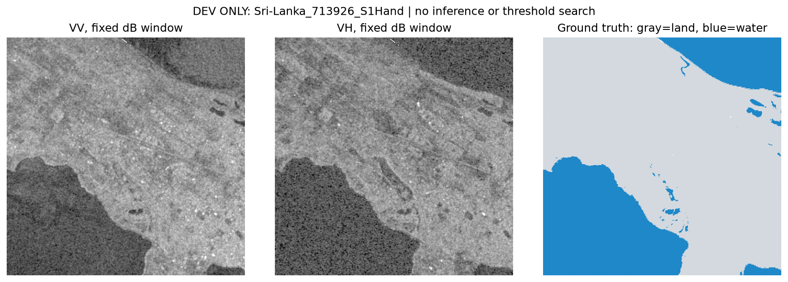

# 02 โจทย์และคำถามวิจัย

ประเภท: สไลด์หลัก · เวลาแนะนำ: 65 วินาที

## ประเด็นที่ต้องการให้ผู้ฟังเข้าใจ

ผู้ฟังต้องรู้ว่าอินพุตคืออะไร Ground Truth หมายถึงอะไร และงานกำลังตอบคำถามใด

## ข้อความบนสไลด์

- อินพุต: Sentinel-1 SAR สองแบนด์ VV และ VH
- เป้าหมาย: ความน่าจะเป็นของน้ำผิวดินรายพิกเซล ณ เวลาถ่ายภาพ
- คำถาม: Sampling ช่วยเพิ่มคะแนนข้ามเหตุการณ์หรือไม่ และผลไวต่อ seed เพียงใด?
- คำถามต่อเนื่อง: Ensemble และ UQ ช่วยบอกพฤติกรรมที่ควรตรวจเพิ่มได้อย่างไร?

## บทพูดภาษาไทย

ตัวอย่างนี้แสดง VV, VH และป้ายกำกับน้ำในภาพเดียวกัน เราฝึกให้โมเดลสร้าง P(water) รายพิกเซล ซึ่งอาจรวมทั้งน้ำถาวรและน้ำที่เกิดระหว่างเหตุการณ์ งานปัจจุบันใช้ SAR สองแบนด์เท่านั้น การประเมินจึงมุ่งที่การจำแนกน้ำในภาพ ส่วนการพยากรณ์ล่วงหน้าต้องมีโจทย์และข้อมูลเพิ่มเติม เมื่อเปลี่ยนเหตุการณ์ ภูมิประเทศและลักษณะภาพอาจต่างไป เราจึงตรวจทั้งคะแนน ความผันผวนจากการฝึก และความไม่แน่นอนของผลทำนาย

## ภาพหรือตารางและการจัดวาง

ใช้ภาพ VV/VH/GT เต็มความกว้างด้านล่าง เก็บคำถามวิจัยไว้ด้านบน ภาพคือ Sri-Lanka_713926 จาก DEV

## หลักฐานสำหรับผู้จัดทำ

Claim IDs: C01, C02

- [ตัวอ่านอินพุตและ labels](../../train_sar_unet.py)
- [ตัวเลขและ metadata ของ raster](../evidence/verified_rasters.csv)
- [ข้อมูลชุดข้อมูลจากผู้จัดทำ](https://github.com/cloudtostreet/Sen1Floods11)

## ขอบเขตการตีความ

อย่าเรียก Ground Truth ว่าแผนที่น้ำท่วมเกิดใหม่ทั้งหมด และอย่าอ้างการพยากรณ์อนาคต
