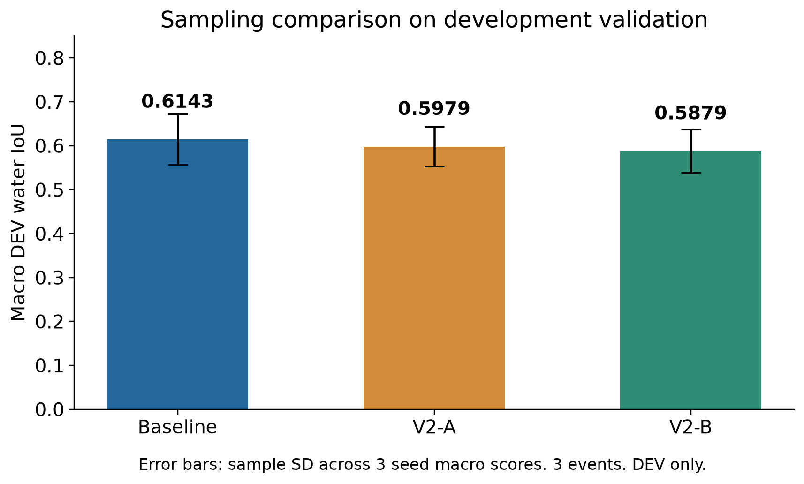

# 07 Sampling ทั้งสองแบบยังไม่เพิ่มคะแนนรวม

ประเภท: สไลด์หลัก · เวลาแนะนำ: 70 วินาที

## ประเด็นที่ต้องการให้ผู้ฟังเข้าใจ

ตอบคำถามวิจัยข้อแรกด้วยผลจริง แม้ว่าวิธีใหม่จะไม่ชนะ

## ข้อความบนสไลด์

| วิธี | Macro DEV IoU | SD ข้าม seed macros | ผลต่างจาก Baseline |
| --- | --- | --- | --- |
| Baseline | 0.6143 | 0.0576 | +0.0000 |
| V2-A | 0.5979 | 0.0457 | -0.0164 |
| V2-B | 0.5879 | 0.0488 | -0.0264 |

Baseline มีค่าเฉลี่ยสูงสุดในสามวิธีที่ทดลอง

Error bars: Sample SD ของ 3 seed macro scores

## บทพูดภาษาไทย

ภายใต้ข้อมูลและโปรโตคอลนี้ Baseline ได้ค่าเฉลี่ยสูงสุด V2-A ต่ำกว่าประมาณ 0.0164 IoU points และ V2-B ต่ำกว่าประมาณ 0.0264 IoU points ผลนี้ยังไม่สนับสนุนว่าการปรับ sampling สองแบบช่วยเพิ่มคะแนนรวม เรารายงานผลตามที่ได้ และยังไม่สรุปว่าวิธีเหล่านี้ใช้ไม่ได้ในข้อมูลหรือเงื่อนไขอื่น การทดลองนี้ไม่ได้ทำการทดสอบนัยสำคัญทางสถิติ

## ภาพหรือตารางและการจัดวาง

ใช้กราฟเป็นภาพหลัก ตารางเป็นตัวเลขสำหรับนำไปทำ native chart หรือเก็บไว้ใน notes ไม่จำเป็นต้องแสดงซ้ำทั้งตารางและกราฟเต็มหน้า

## หลักฐานสำหรับผู้จัดทำ

Claim IDs: C13

- [คำนวณใหม่จาก checkpoint/history](../evidence/verified_models.csv)
- [หลักฐานราย run](../evidence/verified_runs.csv)
- [ที่มากราฟ](../assets/figure_sources.csv)

## ขอบเขตการตีความ

กล่าวได้ว่า Baseline มี mean สูงสุดใน DEV นี้ หลีกเลี่ยงคำว่าเหนือกว่าอย่างมีนัยสำคัญหรือแก้ DG ได้สำเร็จ
