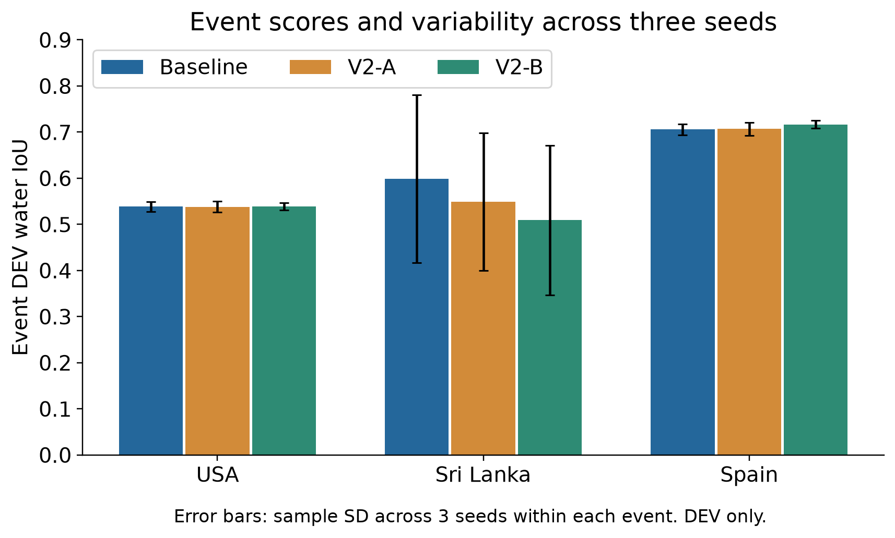

# 08 คะแนนและความผันผวนต่างกันตามเหตุการณ์

ประเภท: สไลด์หลัก · เวลาแนะนำ: 70 วินาที

## ประเด็นที่ต้องการให้ผู้ฟังเข้าใจ

ค่าเฉลี่ยรวมอาจซ่อนความไม่เสถียรของบางพื้นที่

## ข้อความบนสไลด์

| DEV event | Baseline | V2-A | V2-B |
| --- | --- | --- | --- |
| USA | 0.5383 | 0.5381 | 0.5384 |
| Sri Lanka | 0.5989 | 0.5486 | 0.5090 |
| Spain | 0.7058 | 0.7071 | 0.7164 |

Sri Lanka มีความผันผวนข้าม seeds สูง

Baseline Sri Lanka: 0.7065 / 0.7011 / 0.3891

## บทพูดภาษาไทย

เมื่อแยกตามพื้นที่ USA มีค่าใกล้กันทั้งสามวิธี Spain ดีขึ้นเล็กน้อยใน V2-B แต่ Sri Lanka มีความผันผวนสูง Baseline seed 42 และ 123 ได้ใกล้ 0.70 ขณะที่ seed 777 เหลือประมาณ 0.39 วิธี V2-B ช่วย seed 777 แต่ทำให้ seed 123 ลดลงมาก จึงยังอ้างว่าแก้ความไม่เสถียรได้สม่ำเสมอไม่ได้ คะแนนในกราฟเป็น mean ข้าม seeds และ error bars เป็น Sample SD ภายใน event

## ภาพหรือตารางและการจัดวาง

ใช้กราฟแยก event หนึ่งภาพ พร้อมข้อความ seed scores ของ Sri Lanka สั้น ๆ หากผู้ฟังถามเปิด Appendix B ดูทุก seed

## หลักฐานสำหรับผู้จัดทำ

Claim IDs: C14

- [คะแนนเฉลี่ยราย event](../evidence/verified_events.csv)
- [คะแนนทุก seed](../evidence/verified_runs.csv)

## ขอบเขตการตีความ

ความต่างระหว่างประเทศปนกับเหตุการณ์ สภาพภาพและโมเดลที่ฝึกต่างกัน ไม่ใช่การประมาณผลเชิงสาเหตุของประเทศ
