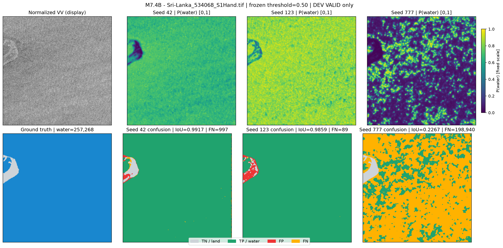

# 09 ตัวอย่างการพลาดน้ำใน Sri Lanka

ประเภท: สไลด์หลัก · เวลาแนะนำ: 65 วินาที

## ประเด็นที่ต้องการให้ผู้ฟังเข้าใจ

ให้ผู้ฟังเห็นว่าความต่างข้าม seed แสดงออกเชิงพื้นที่อย่างไร

## ข้อความบนสไลด์

**ภาพ Sri-Lanka_534068**

Ground Truth มีน้ำ 98.14% ของ valid pixels

| Seed | IoU ของภาพนี้ |
| --- | --- |
| 42 | 0.9917 |
| 123 | 0.9859 |
| 777 | 0.2267 |

Seed 777 พลาดพื้นที่น้ำจำนวนมากในภาพตัวอย่างนี้

## บทพูดภาษาไทย

ในภาพนี้มีน้ำเกือบเต็มภาพ Seed 42 และ 123 ตรวจน้ำได้เกือบทั้งหมด แต่ seed 777 ให้ P(water) ต่ำในบริเวณกว้าง สีส้มใน confusion map คือ False Negative ซึ่งเป็นพิกเซลน้ำที่โมเดลทำนายว่าไม่มีน้ำ ภาพนี้ช่วยให้เห็นปัญหาที่คะแนนรวมเพียงค่าเดียวอธิบายไม่ครบ และเป็นหนึ่งในหลักฐานที่นำไปสู่การทดลอง water-coverage sampling อย่างไรก็ตาม ภาพตัวอย่างนี้ไม่ได้พิสูจน์ว่าความไม่สมดุลของสัดส่วนน้ำเป็นสาเหตุทั้งหมด

## ภาพหรือตารางและการจัดวาง

ใช้ภาพเปรียบเทียบเดิมทั้งภาพ รักษา legend ของ TP/FP/FN ไว้ เก็บตาราง IoU เป็น notes หากพื้นที่สไลด์ไม่พอ

## หลักฐานสำหรับผู้จัดทำ

Claim IDs: C15

- [ตารางกรณีตัวอย่างที่ตรวจแล้ว](../evidence/verified_high_water_cases.csv)
- [ต้นฉบับภาพ](../../results/event_level_v2/m74b_high_water_diagnostics/m74b_Sri-Lanka_534068_comparison.png)

## ขอบเขตการตีความ

เป็น selected DEV case ห้ามอ้างว่าเป็นพฤติกรรมของทุกภาพหรือเป็นหลักฐานสาเหตุเพียงอย่างเดียว
