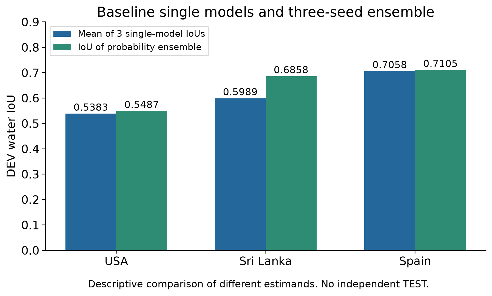

# 10 ผลของ Baseline Deep Ensemble

ประเภท: สไลด์หลัก · เวลาแนะนำ: 75 วินาที

## ประเด็นที่ต้องการให้ผู้ฟังเข้าใจ

การเฉลี่ย probability จากโมเดลที่ฝึกคนละ seed ให้ผล DEV อีกแบบหนึ่ง

## ข้อความบนสไลด์

เฉลี่ย P(water) จาก Baseline seeds 42, 123, 777 ภายใน fold เดียวกัน ก่อน threshold 0.50

| DEV event | Mean single-model IoU | Ensemble IoU |
| --- | --- | --- |
| USA | 0.5383 | 0.5487 |
| Sri Lanka | 0.5989 | 0.6858 |
| Spain | 0.7058 | 0.7105 |

**Macro DEV Ensemble IoU = 0.6483**

เทียบ Mean single-model Macro IoU = 0.6143 · ผลต่าง +0.0340 IoU points

## บทพูดภาษาไทย

เราใช้ Baseline สามโมเดลของแต่ละ fold มารวม probability รายพิกเซล แล้ว threshold ทีเดียว ไม่ได้รวมสาม sampling methods และไม่ได้รวมโมเดลข้าม folds ซึ่งอาจทำให้ภาพของเหตุการณ์นั้นเคยอยู่ใน TRAIN ของสมาชิกบางตัว Ensemble ให้ Macro DEV IoU สูงกว่าค่าเฉลี่ยโมเดลเดี่ยวในการเปรียบเทียบนี้ โดยผลต่างเด่นที่สุดใน Sri Lanka แต่ค่าเฉลี่ยคะแนนโมเดลเดี่ยวกับคะแนนของ probability ensemble เป็นการสรุปคนละแบบ และใช้ DEV ที่ผ่านการเลือก checkpoint แล้ว จึงยังต้องทดสอบอิสระต่อไป

## ภาพหรือตารางและการจัดวาง

กราฟเปรียบเทียบราย event พร้อมตัวเลข macro ด้านบน ระบุ Mean single-model กับ Ensemble ให้ตรงกัน

## หลักฐานสำหรับผู้จัดทำ

Claim IDs: C16, C17

- [ผล Ensemble ที่ตรวจการรวมใหม่](../evidence/verified_ensemble_events.csv)
- [สมาชิกและ SHA-256](../../results/event_level_v2/m80a_dev_ensemble_uq/m80a_members.csv)
- [การทำนายซ้ำเก้าภาพบน CPU](../evidence/cpu_preview_recheck.csv)
- [Deep Ensembles ต้นฉบับ](https://papers.neurips.cc/paper/2017/hash/9ef2ed4b7fd2c810847ffa5fa85bce38-Abstract.html)

## ขอบเขตการตีความ

การประเมินมี Ensemble แยกตาม fold สามชุด ไม่ใช่ Ensemble 9 โมเดลชุดเดียว และไม่ใช่การพิสูจน์ผลบน Independent TEST
