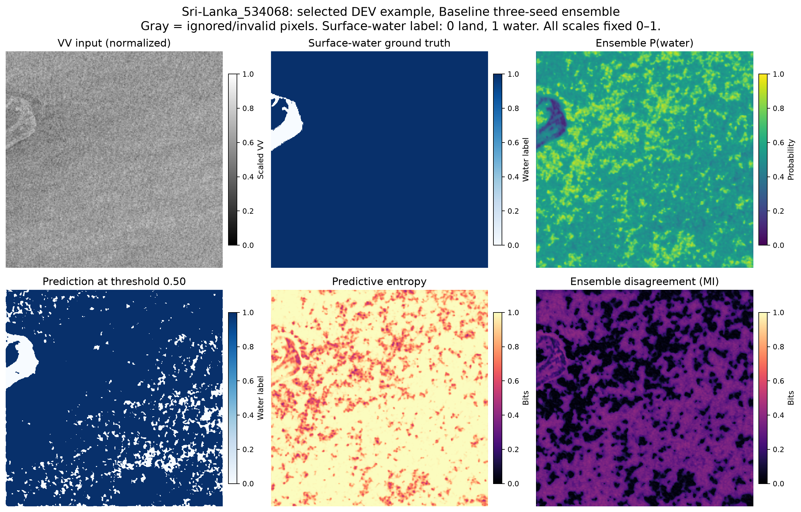

# 11 แผนที่ความไม่แน่นอนของ Ensemble

ประเภท: สไลด์หลัก · เวลาแนะนำ: 80 วินาที

## ประเด็นที่ต้องการให้ผู้ฟังเข้าใจ

อธิบายว่า Entropy กับ MI บอกอะไร และเหตุใด uncertainty ต่ำจึงยังผิดได้

## ข้อความบนสไลด์

- Predictive Entropy: ความไม่แน่นอนของ probability เฉลี่ย
- Mutual Information: ความเห็นต่างของสมาชิก Ensemble
- ผลระดับภาพครอบคลุม 141 DEV chips
- การตรวจจับข้อผิดพลาดระดับพิกเซลอย่างละเอียดมีเพียง 9 ภาพที่คัดเลือกไว้

สมาชิกอาจทำนายผิดไปทางเดียวกันและให้ MI ต่ำได้

## บทพูดภาษาไทย

ภาพหกช่องนี้แสดง SAR, Ground Truth, probability เฉลี่ย, binary prediction, predictive entropy และ MI ตามลำดับ Entropy สูงเมื่อ probability ใกล้ 0.5 ส่วน MI สะท้อนว่าผลของสมาชิกต่างกันเพียงใด เราสร้างผลระดับภาพครบ 141 ภาพ แต่เก็บ arrays สำหรับการตรวจ pixel-level แบบละเอียดไว้เพียงเก้าภาพที่เลือก จึงต้องแยกขอบเขตสองส่วนนี้ ข้อมูล UQ ใช้ช่วยวิเคราะห์และจัดลำดับการตรวจเพิ่มได้ แต่ค่า uncertainty ต่ำยังไม่รับประกันว่าคำทำนายถูกต้อง

## ภาพหรือตารางและการจัดวาง

ใช้ภาพหกช่องเต็มความกว้าง ระบุ Selected Sri Lanka DEV example และใช้พื้นที่ข้อความเพียงเล็กน้อย ตาราง UQ และการจับ error อยู่ Appendix C

## หลักฐานสำหรับผู้จัดทำ

Claim IDs: C18, C19, C20

- [ผล UQ ทั้งสาม event](../evidence/verified_ensemble_events.csv)
- [คำนวณ error capture จาก arrays ใหม่](../evidence/verified_selected_uq_events.csv)
- [สูตร uncertainty ในโค้ด](../../m80a_dev_ensemble_uq.py)

## ขอบเขตการตีความ

MI เป็น ensemble disagreement proxy หลีกเลี่ยงการเรียกว่าแยก epistemic/aleatoric uncertainty ได้สมบูรณ์ หรือรับรองความปลอดภัยในการตัดสินใจ
