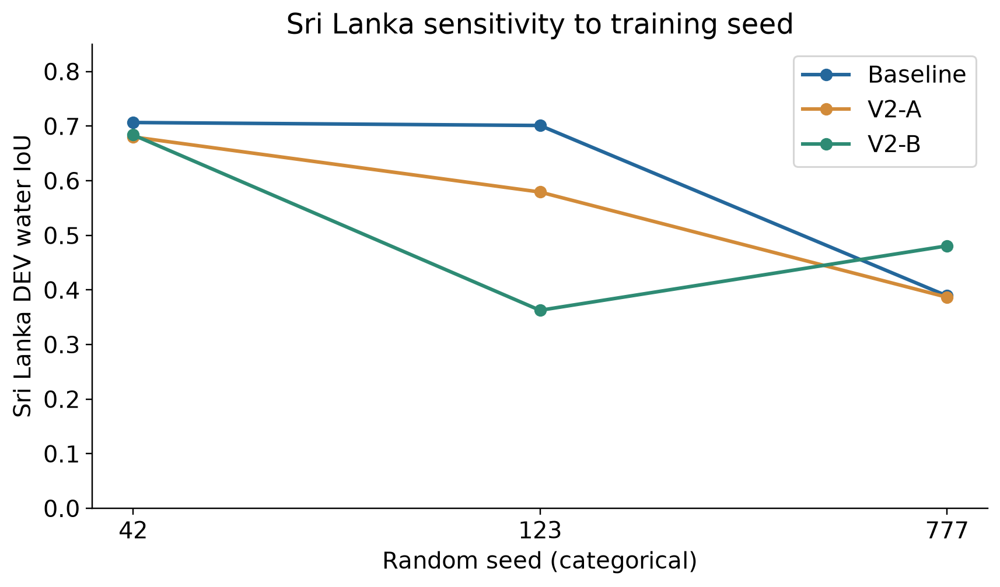

# Appendix B คะแนนครบ 27 Runs

ประเภท: สไลด์สำรอง · เวลาแนะนำ: 50 วินาที

## ประเด็นที่ต้องการให้ผู้ฟังเข้าใจ

ข้อมูลสำรองสำหรับตรวจว่า mean ซ่อนพฤติกรรม seed ใดไว้

## ข้อความบนสไลด์

| Method | Seed | USA | Sri Lanka | Spain |
| --- | --- | --- | --- | --- |
| Baseline | 42 | 0.5289 | 0.7065 | 0.6940 |
| Baseline | 123 | 0.5367 | 0.7011 | 0.7176 |
| Baseline | 777 | 0.5494 | 0.3891 | 0.7057 |
| V2-A | 42 | 0.5442 | 0.6801 | 0.6910 |
| V2-A | 123 | 0.5247 | 0.5792 | 0.7170 |
| V2-A | 777 | 0.5452 | 0.3866 | 0.7132 |
| V2-B | 42 | 0.5292 | 0.6839 | 0.7068 |
| V2-B | 123 | 0.5434 | 0.3626 | 0.7231 |
| V2-B | 777 | 0.5426 | 0.4806 | 0.7192 |

## บทพูดภาษาไทย

แต่ละช่องคือ event-level pixel-micro Water IoU จาก checkpoint ของ fold และ seed นั้น ทุก checkpoint ผ่านการเทียบกับ history, epoch, threshold, seed, counts และสถาปัตยกรรมในรอบตรวจนี้ กราฟเส้นแสดง Sri Lanka เพื่อให้เห็นว่าการเปลี่ยน sampling ช่วยและทำให้แย่ลงต่างกันในแต่ละ seed

## ภาพหรือตารางและการจัดวาง

ใช้ตารางหรือกราฟอย่างใดอย่างหนึ่งต่อหน้า หากต้องการดู VALID IoU/Recall/Precision/Loss ตาม epoch ให้เปิดภาพ 06_sri_lanka_learning_curves.png จาก assets

## หลักฐานสำหรับผู้จัดทำ

Claim IDs: C11, C14, C24

- [verified_runs.csv](../evidence/verified_runs.csv)
- [checks.csv](../evidence/checks.csv)

## ขอบเขตการตีความ

Seed เป็นหมวดหมู่ เส้นเชื่อมในกราฟใช้ติดตามวิธีเดียวกัน ไม่สื่อความสัมพันธ์ต่อเนื่องตามค่า seed
