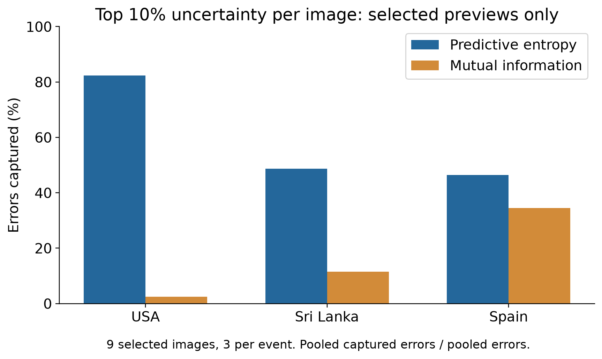

# Appendix C ขอบเขตและผลเชิงตัวเลขของ UQ

ประเภท: สไลด์สำรอง · เวลาแนะนำ: 60 วินาที

## ประเด็นที่ต้องการให้ผู้ฟังเข้าใจ

แยกผลทั้ง 141 ภาพออกจากการตรวจจับ error ในเก้าภาพที่เลือก

## ข้อความบนสไลด์

**ผลรวมราย event จาก 141 DEV ภาพ**

| DEV event | Recall | Brier | Entropy (bits) | MI (bits) |
| --- | --- | --- | --- | --- |
| USA | 0.7049 | 0.0420 | 0.6349 | 0.0511 |
| Sri Lanka | 0.7311 | 0.0451 | 0.5180 | 0.0335 |
| Spain | 0.8128 | 0.0338 | 0.2988 | 0.0085 |

**Error detection เฉพาะ 9 selected images**

| พื้นที่ (3 ภาพที่เลือกต่อพื้นที่) | Entropy capture | MI capture |
| --- | --- | --- |
| USA | 82.4% | 2.4% |
| Sri Lanka | 48.7% | 11.5% |
| Spain | 46.4% | 34.5% |

## บทพูดภาษาไทย

Brier และ mean uncertainty ด้านบนรวมทุก valid pixel ของ event ส่วนตารางด้านล่างเลือก 10% ของ valid pixels ที่มี uncertainty สูงที่สุดภายในแต่ละภาพ แล้วนับว่าครอบคลุม FP+FN ได้กี่พิกเซล จากนั้นรวมตัวเศษและตัวส่วนข้ามสามภาพของ event นั้น ตัวเลขนี้ไม่ใช่ precision ของการตรวจ error และไม่ใช่สถิติ error detection ของทั้ง 141 ภาพ ภาพ Sri Lanka บางภาพถูกเลือกจากกรณีศึกษาที่ทราบอยู่ก่อน จึงมี selection bias

## ภาพหรือตารางและการจัดวาง

ตารางสองขอบเขตนี้อาจแยกสองหน้าสำรองได้ แสดงข้อความ Selected 9 only ติดกับกราฟ capture เสมอ

## หลักฐานสำหรับผู้จัดทำ

Claim IDs: C18, C19, C20

- [ผลรวม Ensemble](../evidence/verified_ensemble_events.csv)
- [ผลรายภาพที่คัดเลือก](../evidence/verified_selected_uq_images.csv)
- [สูตรรวมใหม่](../evidence/verified_selected_uq_events.csv)
- [preview_selection ต้นทาง](../../m80a_dev_ensemble_uq.py)

## ขอบเขตการตีความ

Brier ต่ำอาจเกิดร่วมกับการตรวจน้ำไม่ครบ ค่า mean entropy ข้าม event ยังขึ้นกับสัดส่วนคลาสและฉาก ไม่ควรใช้จัดอันดับความน่าเชื่อถือโดยลำพัง
