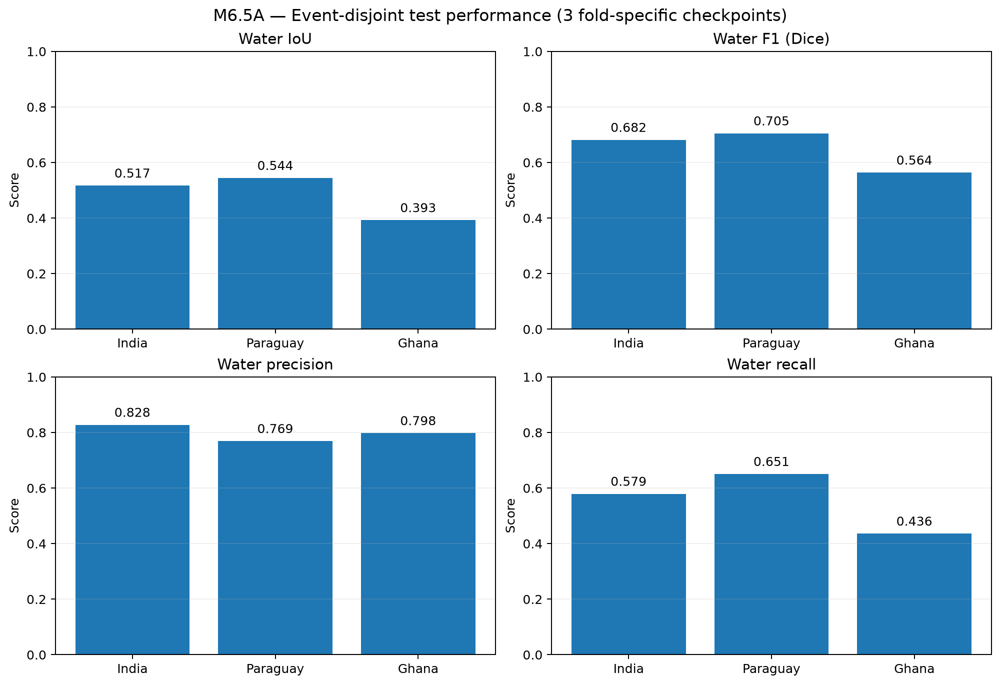

# M6.5A — Baseline Event-Level Performance Summary

**Study design:** Three event-disjoint test folds, each evaluated with its own independently trained Small U-Net checkpoint and fixed classification threshold 0.5. The fold comparisons are descriptive; the trained models and validation events are different.

## Dataset partitions

| Fold | Train images | Validation event (n) | Test event (n) | Bolivia external holdout |
|---|---:|---|---|---|
| fold_01_india | 288 | USA (69) | India (68) | 15 (not used for model selection) |
| fold_02_paraguay | 317 | Sri-Lanka (42) | Paraguay (66) | 15 (not used for model selection) |
| fold_03_ghana | 347 | Spain (30) | Ghana (48) | 15 (not used for model selection) |

## Test segmentation results

| Held-out event | IoU | F1 (derived) | Precision | Recall |
|---|---:|---:|---:|---:|
| India | 0.5169 | 0.6816 | 0.8277 | 0.5793 |
| Paraguay | 0.5444 | 0.7050 | 0.7692 | 0.6507 |
| Ghana | 0.3925 | 0.5638 | 0.7976 | 0.4359 |

## Supplementary probability diagnostics

| Event | Brier ↓ | NLL ↓ | ECE ↓ | GT water with P(water)<0.1 ↓ | Low-P portion of FN ↓ |
|---|---:|---:|---:|---:|---:|
| India | 0.05598 | 0.21181 | 0.02886 | 31.4% | 74.5% |
| Paraguay | 0.03928 | 0.17540 | 0.07438 | 6.3% | 18.2% |
| Ghana | 0.03458 | 0.13171 | 0.01844 | 34.9% | 61.8% |

## Findings (descriptive only)

- **Paraguay** has the highest observed test IoU (0.5444) and **Paraguay** the highest recall (0.6507).
- **Ghana** has the lowest test IoU (0.3925) and substantial missed ground-truth water.
- Better whole-image probability scores (Brier/NLL/ECE) do not necessarily imply better water recall, particularly with many land pixels.
- Results are observational; they do not isolate geography from changes in training events, selected checkpoint, or ground-truth distribution.

## Reproducibility / interpretation boundaries

1. Do not select hyperparameters, adjust thresholds, or calibrate based on these already inspected TEST events.
2. Each TEST event belongs to a separate fold-specific checkpoint; do not pool pixels as if a single model had been evaluated on all three events.
3. The count of 15 Bolivia holdout images is retained in each fold but is not added to these per-fold TEST scores.
4. Thailand pilot agreement with UNOSAT is NOT equivalent to independently verified water/land test labels.
5. F1 is derived using the binary micro relation F1 = 2*IoU/(1+IoU), not re-estimated from independent model inference.
6. The train/validation counts and event labels shown here are taken from previously supplied fold logs; the script cross-checks test metrics against evaluation_summary.csv when those files exist.

## Suggested figure

